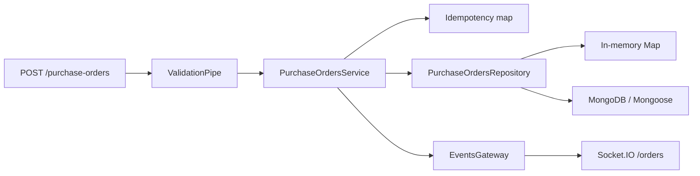

# prospex-cloud-api

A production-shaped **NestJS + MongoDB** procurement API: purchase orders,
approval workflow, idempotent writes, validation and WebSocket events.

This is a portfolio reference implementation, not a production system. It exists
to make the procurement/ERP integration ideas concrete: a typed domain, a
repository seam between MongoDB and an in-memory fallback, an approval state
machine, idempotency keys and events for downstream systems.

## Stack

| Layer | Choice |
|---|---|
| Runtime | Node.js 22, TypeScript |
| Framework | NestJS 11 |
| Persistence | MongoDB 7 via Mongoose 8; in-memory fallback without `MONGO_URI` |
| Validation | class-validator / class-transformer |
| Events | Socket.IO namespace `/orders` |
| Tests | Jest + Supertest (in-memory and MongoDB modes) |
| CI | GitHub Actions: build, tests, MongoDB service job |

## Endpoints

| Method | Route | Behaviour |
|---|---|---|
| `GET` | `/health` | Health + active repository |
| `POST` | `/purchase-orders` | Create a pending order; supports `Idempotency-Key` |
| `GET` | `/purchase-orders` | List orders, newest first |
| `GET` | `/purchase-orders/:id` | Fetch one order |
| `PATCH` | `/purchase-orders/:id/approve` | Approve a pending order |
| `PATCH` | `/purchase-orders/:id/reject` | Reject a pending order |

WebSocket clients connected to `/orders` receive `purchase_order.created` and
`purchase_order.decided` events.

## Run

```bash
npm ci
npm run start:dev
```

Without `MONGO_URI`, the API uses an in-memory repository, so it runs anywhere.
With MongoDB:

```bash
MONGO_URI='mongodb://127.0.0.1:27017/prospex' npm run start:dev
```

## Test

```bash
npm test
```

The default test job uses the in-memory repository. The CI `mongo` job sets
`MONGO_URI` to a MongoDB service container and runs the same suite against the
real Mongoose repository.

## Architecture



## Honest boundaries

- No authentication, RBAC or tenant isolation yet; the repository seam is where
  a tenant-scoped query would go.
- `erpReference` models the ERP integration key; there is no live Oracle Fusion
  or SAP adapter in this sample.
- The in-memory repository is for local development and fast tests. MongoDB is
  the production path.
- No GCP deployment is claimed; the service is container-ready and can run on
  Cloud Run, GKE or any Node host.
